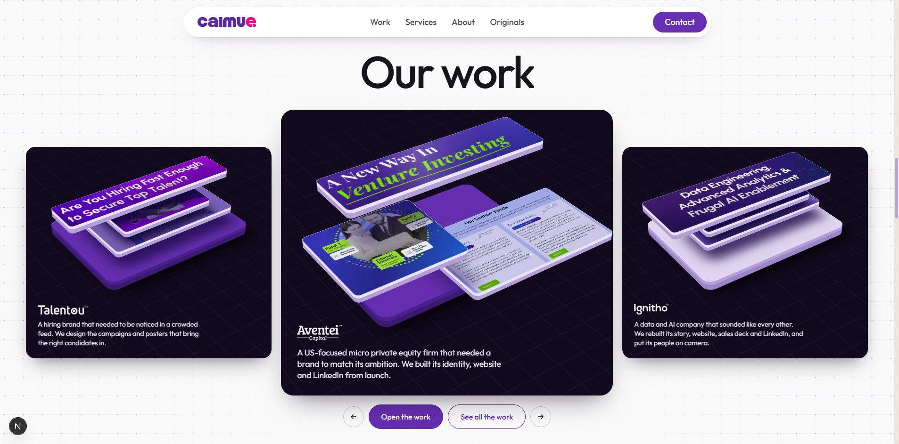

# Work carousel (archived)

Removed from the homepage on 2 Nov 2026, when the Home Page content moved to v2 and no longer had a work section. It isn't deleted and is meant to be reused on another page. Nothing imports it at the moment, so it adds nothing to the site's bundle.



## What it is

A one-screen "Our work" section with a looping row of dark cards. The centre card is larger and in front. Each card is an isometric space, in the same visual language as the homepage's service floor, holding the work as a stack of thick floating sheets cut from tight crops. The stack opens as a card reaches the centre and closes as it leaves.

- **Moving it:** sideways trackpad or wheel scroll, mouse drag, the arrow buttons, and keyboard arrows when the row has focus. Up and down still scroll the page.
- **Clicking:** a side card comes to the centre. The centre card, or "Open the work", grows the work to the full screen. In that view, Esc closes and the arrow keys change client.
- **Words:** logo and sentence are always on the card, never on hover.
- **Pointer:** turns the centre stack a few degrees.

## Files

| File | Purpose |
|---|---|
| `WorkCarousel.tsx` | The section: data, stack building, row movement, full-screen viewer |
| `work-carousel.css` | Its styles (`wc-` for the section, `wk-` for the viewer) |
| `arena/` | The three competing prototypes, their rationales, and screenshots |

Images are in `public/work/` (`slug.webp` 1440x3600, `slug-sm.webp` 900x2250). Logos are in `public/logos/trim/`. Don't delete these while this section may come back.

## Using it on a page

```tsx
import { WorkCarousel } from "@/components/sections/work-carousel/WorkCarousel";

<WorkCarousel />
```

It needs a little from the page around it:

- The `ca-pad`, `ca-screen`, `ca-head`, `ca-h2` and `ca-btn` classes from `sections/home/home-v3.css` and `home-polish.css`. Import those, or restyle these classes in `work-carousel.css`.
- `--ed-edge` and the other `--ed-` tokens from `home-polish.css`.
- GSAP, which is already a dependency.
- A height for the row. It measures `.wc-rail`, so the section must give it real height (`ca-screen` does this on desktop).

The "See all the work" button links to `/brands`. Check that this is still right.

## Adding work

Each client in `WORK` has two lists:

- `pieces`: everything shown in the full-screen view, in order, as any images.
- `stack`: one to three sheets floating in the card, bottom to top. `crop` is `[x, y, w, h]` in the picture's own pixels and `w` is the sheet's width in the card.

Posters, deck pages and film frames work the same way as website captures. Give a single sheet for a poster. The one-sheet layout is written but has not been seen rendered yet, so check it the first time it is used.

**Cookie bars:** the Aventei capture has one at y 835 to 932 and Ignitho's at y 838 to 900 (1440-wide pixels). Crops must stay clear of them. `cut` hides them in the full-screen view.

**Content check before reuse:** the sentences come from the old content, and Simbfi is no longer in the v2 client list (Prodeia is new). Check clients and wording against the current content document.

## How this design was reached

The owner rejected each of these, in order:

1. Pushed version: 3D folders in a glass box ("cheap").
2. Isometric box with hover text ("hover to show text", "cheap").
3. Sideways row of site screenshots, then an index of clients beside a travelling frame. Rejected because the section will hold many types of work, not only websites.
4. Clean stacked 3D folders. Rejected in favour of side-by-side cards with one in front.
5. Flat looping cards, then the same as one card with the screenshot framed on purple and ink ("looks like a design from early 2000").

The reason throughout: the only imagery is screenshots of client sites, and shown flat they carry their own dated look. The treatment has to supply the lighting, material, depth and crop.

### The arena (2 Nov 2026)

Three designers each built one direction, and an independent judge on a different model scored the renders.

| Direction | Not dated or cheap | 3D space | Same hand as Hero and Services | Any type of work | Readable | Weight to ship | Total |
|---|---|---|---|---|---|---|---|
| **C: exploded isometric stack (winner)** | 8 | 7 | 9 | 6 | 7 | 7 | **44** |
| B: real WebGL slabs | 7 | 8 | 7 | 8 | 8 | 3 | 41 |
| A: lit room with a reflective floor | 5 | 7 | 6 | 7 | 6 | 7 | 38 |

- **A lost** on the mirrored floor and spotlight, which are old 3D-web habits, and a lavender leaf that read as an open brochure.
- **B lost** on risk: a 150 KB library and a flat fallback without a GPU.
- **Grafted into C:** a band of light that travels across the top sheet (from B) and light falling off down that sheet (from A).
- **Removed from C:** the thin pin lines, which read like a dashboard illustration.

## Known weak points

- **Smoothness is unproven on a real graphics card.** Headless test runs showed occasional frame spikes.
- **Floating isometric stacks are a known SaaS illustration style.** The design is on-brand, not unique. Real campaign and film images would lift it most.
- **No designed phone layout yet.** There is only a basic fallback in the CSS.

## Project memory at the time

Copied from the assistant's notes so it stays with the code:

> Work: `WorkCarousel.tsx`, white section. Looping row of dark ink cards, centre in front; each card is an isometric space (arena winner, same world as the service floor) holding the work as a stack of thick sheets cut from tight crops, which opens at the centre. `stack` takes one to three sheets of any picture. Words always on the card.
>
> Work will not stay websites only; it will hold many types of work, so the owner rejected the website-screenshot index and row. On 2 Nov they also dropped the stacked 3D folders for this centred carousel, so do not bring folders back. Flat screenshot cards, even framed on purple and ink, were called "early 2000". Also rejected: one treatment repeated across sections, hover-to-reveal text.
>
> Keep each section's layout different. Never reveal Work text on hover. Don't design Work around websites. Background colours from commit 217b80f must not change on the homepage: this section's ground is white with a faint grid.

Standing rules from the owner that apply here: no all caps, no full stops in headings, headings top centre, never invent copy, logos sized by the lettering's real height, and whole-card hover lift only (about 4px).
